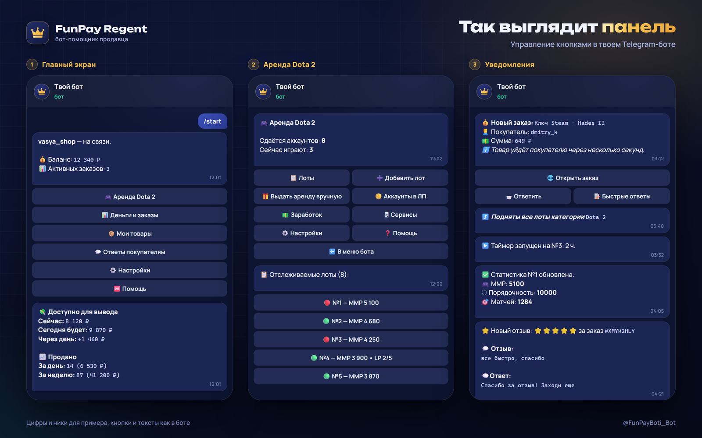

# FunPay Regent - бот для продавцов FunPay

Автовыдача, автоподнятие лотов, ответы покупателям и аренда аккаунтов Dota 2. Бот работает 24/7 на нашем сервере: устанавливать ничего не надо, компьютер можно выключать. Управление кнопками в Telegram.

**Страница:** https://vadim556.github.io/funpay-regent/
**Бот:** [@FunPayBoti_Bot](https://t.me/FunPayBoti_Bot?start=ad-github)
**Новости:** [@FP_bots](https://t.me/FP_bots)

## Что умеет

- Автовыдача сразу после оплаты, днем и ночью
- Поднятие лотов, как только FunPay дает поднять
- Лот выключается, когда товар кончился, и включается, когда появился
- Приветствие, ответы на команды и на отзывы твоими текстами
- Напоминание покупателю подтвердить заказ
- Статистика продаж и денег на удержании
- Уведомления и ответы покупателям из Telegram
- Переезд с FunPay Cardinal: загружаешь свои файлы автоответа и автовыдачи

## Аренда Dota 2

Бот выдает аккаунты, кикает после матча и после каждой аренды обновляет в лоте ММР, порядочность и жетоны. Кто вышел из игры, получает ЧС.

## Подписки

Regent Plus - 500 ₽ в месяц: весь бот и аренда Steam. Regent Pro - 1000 ₽ в месяц: все из Plus и аренда Dota 2. Сервер, установка и обновления уже в цене. Первые 4 дня бесплатно.

## Исходный код

Здесь только страница с описанием. Regent работает как сервис, исходного кода в этом репозитории нет.

FunPay Regent не является официальным продуктом FunPay.
